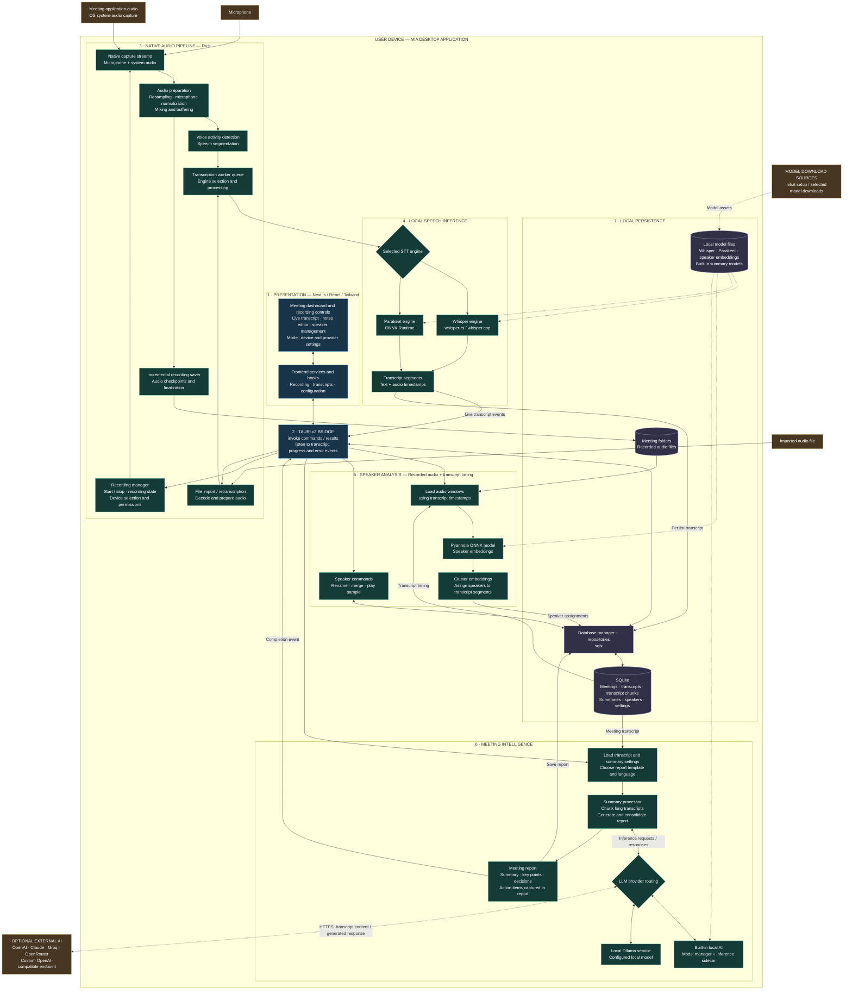

# MIA — Detailed Architecture

This diagram describes the current desktop implementation, inspected on 18 October 2026. It shows logical component relationships rather than exact function call order. Solid arrows show application data/control flow; dashed arrows show optional remote connections or model dependencies.

## Implementation notes

- Speaker analysis requires saved audio and transcript timestamps. It is a separate operation from live transcription.
- Action items are generated as report content; this diagram does not imply an implemented task dispatch or email delivery service.
- Local inference requires downloaded models. Optional remote LLM providers receive transcript content. Ollama is local only when configured with a local endpoint.
- Hardware acceleration depends on the model, build features, and available hardware.
- Error, progress and status events also pass through the Tauri bridge; most individual event arrows are omitted for readability.
- The archived FastAPI backend is not part of this runtime. The proposed Custom Context Engine, browser extension, PostgreSQL, Redis/Celery, Jira/Trello and email automation are not shown as implemented features.

## Code map

| Layer | Implementation |
|---|---|
| UI and frontend service wrappers | `frontend/src/components/`, `frontend/src/hooks/`, `frontend/src/services/` |
| Tauri command registration | `frontend/src-tauri/src/lib.rs` |
| Capture, preprocessing and recording | `frontend/src-tauri/src/audio/` |
| Transcription dispatch and workers | `frontend/src-tauri/src/audio/transcription/` |
| Speech models | `frontend/src-tauri/src/whisper_engine/`, `frontend/src-tauri/src/parakeet_engine/` |
| Speaker embeddings and clustering | `frontend/src-tauri/src/diarization/` |
| Summary processing and provider routing | `frontend/src-tauri/src/summary/processor.rs`, `frontend/src-tauri/src/summary/llm_client.rs` |
| Built-in inference and model lifecycle | `frontend/src-tauri/src/summary/summary_engine/` |
| Database and repositories | `frontend/src-tauri/src/database/` |

Editable diagram source: [architecture-detailed.mmd](architecture-detailed.mmd).
