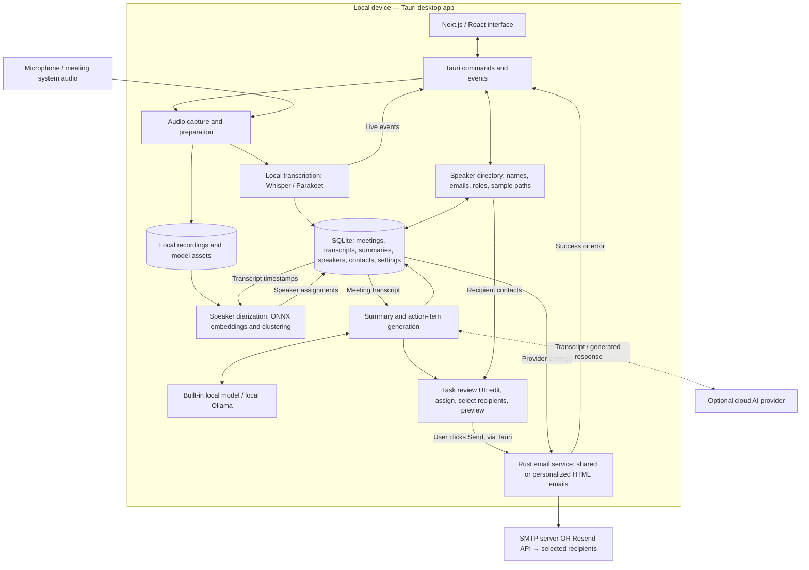

# MIA — Updated Overview Architecture

Mermaid overview of the current desktop application.

Architecture reflects the currently inspected source, including the new speaker directory and task-email workflow. This is a source-based diagram, not a runtime or delivery test.

- Speaker analysis uses saved audio and transcript timing. The contact directory is not depicted as automatic voice-to-person recognition.
- Tasks are parsed from the generated report in the interface. Users can edit assignments, select tasks and recipients, preview content, and choose shared or individual task emails.
- SMTP uses the Rust `lettre` client; Resend uses HTTPS. Email content leaves the device when sent. Optional remote LLM generation also sends transcript content to the selected provider.
- FastAPI remains archived. A Custom Context Engine, Redis/Celery, PostgreSQL, and Jira/Trello integration are not shown as implemented.

Source references: `frontend/src-tauri/src/lib.rs`, `frontend/src-tauri/src/email/`, `frontend/src/components/MeetingDetails/SendTasksModal.tsx`, `frontend/src-tauri/src/database/repositories/speaker_directory.rs`, and `frontend/src-tauri/migrations/20261019000000_add_speaker_directory_and_email.sql`.

